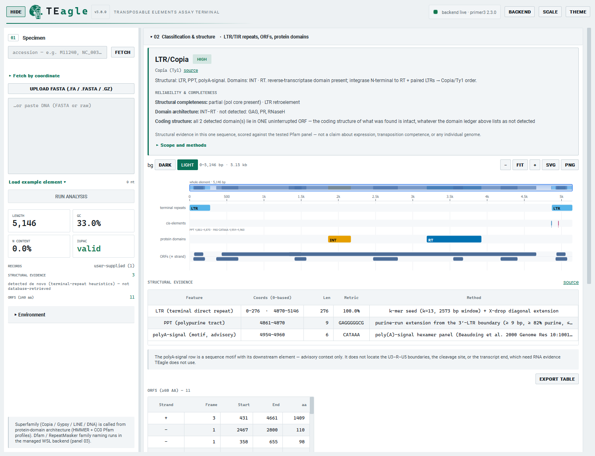

# TEagle


Windows desktop software for evaluating individual transposable-element sequences and planning PCR assays. It combines structural and protein-domain evidence, classification, optional Dfam annotation, Primer3 design and assembly-based candidate-site checks.

[Download](https://github.com/tunabirgun/TEagle/releases/latest) · [Documentation](https://tunabirgun.github.io/TEagle/) · [Changes](CHANGELOG.md)



## Get started

1. Download the Windows x64 installer and illustrated manual from the release page. The installer is unsigned; follow your institution's installation policy.
2. Launch TEagle, choose **Load example element**, and select **Run analysis**, or supply a sequence, FASTA file or NCBI accession.
3. Use **BACKEND** to install optional WSL2 components for Dfam, splice detection or assembly functions.

The Windows bundle includes Qt, Primer3, HMMER and a 30-model Pfam panel. Routine use requires no Python installation. See the [example workflow](docs/TRY-IT-YOURSELF.md) for a reproducible walkthrough.

The default Dfam components require 85 MiB of downloads and 0.6 GiB after extraction, plus package and solver storage. Capacity checks use the smaller limit of WSL filesystem space and Windows backing-drive space. WSL resource limits in `.wslconfig` apply globally. Dfam downloads resume; a partial genome ZIP restarts on retry. See [backend details](app/README.md#the-wsl-backend-optional-linux-dependent-workflows).

## Interpret results

TEagle evaluates a selected sequence or locus. It reports complete, partial, withheld, failed and unexecuted stages separately. Missing database entries or a failed domain stage are not negative biological findings. Predicted primer products require experimental confirmation; assembly checks apply only to the selected assembly and criteria. Manual primer pairs have no intended-locus assignment; omit synthetic 5′ tails.

Exports include tables as XLSX/CSV/TSV, figures as SVG/PNG/vector PDF, sequence annotations as GFF3/BED/FASTA, provenance JSON and complete-result JSON. See the app documentation for coordinate conventions. Whole-genome RepeatMasker annotation is a separate optional function.

## Evidence and citation

The software article is unpublished. Public benchmark materials cover **TEagle 4.0.0**, not subsequent releases or wet-lab performance:

- [Protocol lineage](https://doi.org/10.5281/zenodo.22129307)
- [Controlling protocol](https://doi.org/10.5281/zenodo.22154316)
- [The public 4.0.0 results archive](https://doi.org/10.5281/zenodo.22159977)

Read the [changelog](CHANGELOG.md) before interpreting results from different versions; 4.1.0 changed scientific outputs for some inputs. Use [CITATION.cff](CITATION.cff) and record the software and database versions actually used.

## Development

Source launches require Python 3.12 and install pinned dependencies into the active interpreter; use a virtual environment. `python app/teagle.py --check` reports dependencies without installing them.

```powershell
python app/teagle.py
python app/teagle.py --selftest
python -m pytest tests/ -q
powershell -File installer/build_installer.ps1
```

WSL and network tests are gated separately. See [app documentation](app/README.md) and [third-party notices](THIRD-PARTY-NOTICES.md).

Licensed under [AGPL-3.0-or-later](LICENSE).
