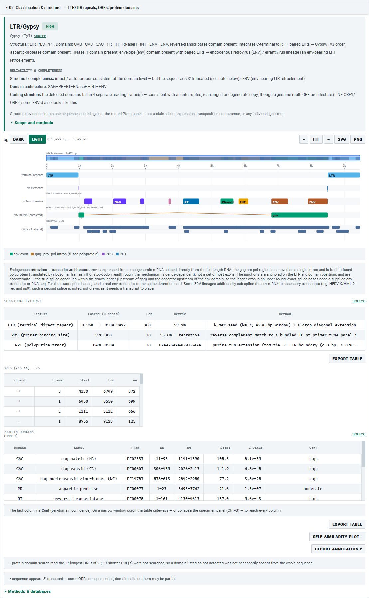
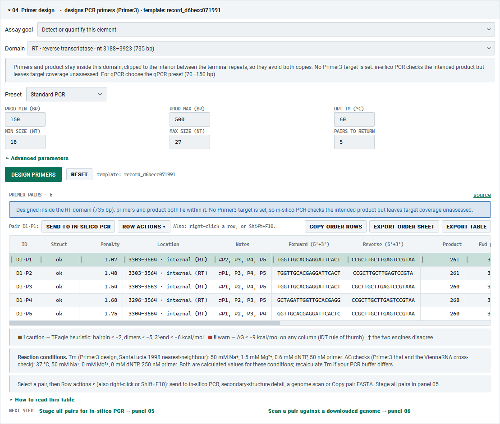
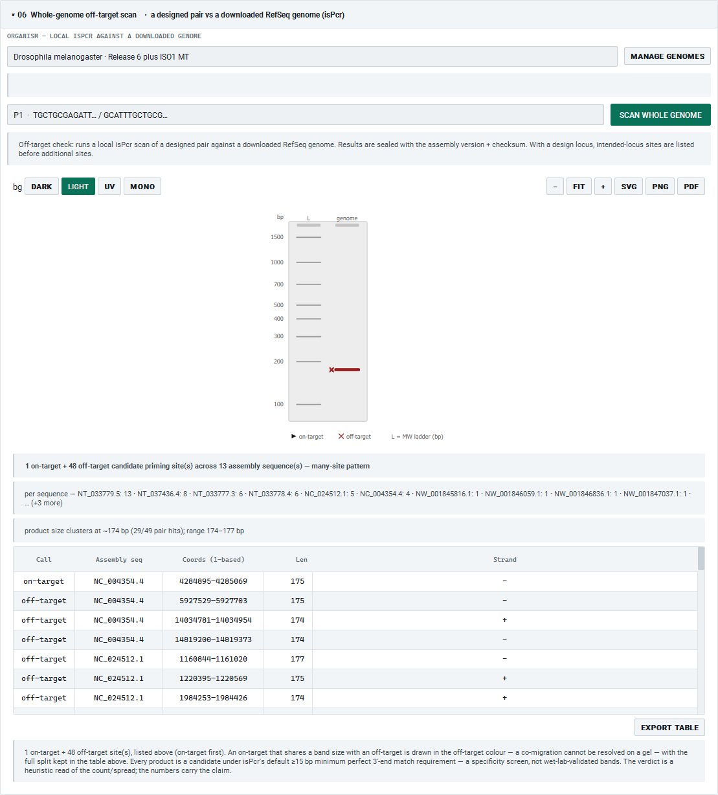

<div align="center">
<picture>
  <source media="(prefers-color-scheme: dark)" srcset="docs/img/teagle-banner-dark.png">
  
</picture>

   
</div>

**TEagle** takes one transposable element and tells you what it is, how it is built, and how to amplify it — in one window, without a command line, and with every result carrying the exact software and database versions that produced it.


## Why it exists

Naming an element, reading its internal structure, and designing a PCR assay for it are normally three separate jobs across three tools, each with its own input format and none of which records how it reached its answer. TEagle joins them, and is built on one rule: **a result must not claim more than its evidence supports.** Where the evidence is thin, the tool says so on screen rather than rounding up to a confident-sounding answer.

It is written for someone who runs benches — not a bioinformatician, not a programmer.

## What it is not

Being clear about this saves time:

- **Not a genome assembler or a variant caller.** It analyses sequence you give it.
- **Not a discovery tool for new TE families.** It recognises families that are already in the library it searches. Finding families nobody has described yet is what RepeatModeler2 and EDTA are for.
- **Not a replacement for wet-lab validation.** Primers are designed and screened *in silico*; the gel it draws is a prediction.
- **Not a web service.** Everything runs on your machine. It fetches sequences from NCBI when you ask it to, and never uploads yours.
- **Not a claim of completeness.** A family absent from the installed library cannot be reported, so absence is never evidence of absence — and the panel says which library was searched.

## Scope

| | |
|---|---|
| **Input** | One element or locus: pasted sequence, a FASTA file, an NCBI accession, or genomic coordinates. Up to roughly tens of kb. |
| **Also** | A whole downloaded genome, for a transposable-element landscape (matched repeat names/models, alignment-row counts, coverage). |
| **Platform** | Windows 10/11, 64-bit. The optional Linux-only steps run in a WSL2 environment the app installs for you. |
| **Offline** | Everything except NCBI fetch and the one-time backend/genome downloads. |

## Getting started

1. Download version 4.0.0 from the [v4.0.0 release](https://github.com/tunabirgun/TEagle/releases/tag/v4.0.0). Earlier releases remain available only for reproducing version-locked results.
2. Verify the SHA-256 value published beside the 4.0.0 installer before running it.
3. Run the installer and launch **TEagle**. It installs per user by default. Select **Clean install** only when you intend to remove an older TEagle configuration, cache, and TEagle-owned backend environments. Linux-side cleanup uses only the distribution previously recorded by TEagle; a missing or invalid record skips Linux cleanup. A cleanup failure stops a clean installation and retains the validated record for retry. During interactive uninstallation, the same failure is reported but uninstallation continues, potentially leaving optional backend data for later removal. TEagle never substitutes another default distribution. The shared micromamba executable and environments belonging to other applications are preserved.
4. *Windows will show a blue **“Windows protected your PC”** SmartScreen warning because the installer is not code-signed and has no publisher reputation. Click **More info → Run anyway**. A managed or institutional computer may block this action, in which case local information-technology staff must approve the executable.*
5. Click **Load example element** for a bundled, published TE (or paste a sequence, open a FASTA, or type an NCBI accession) and press **Run analysis**.

The Windows bundle includes everything the native core needs — Python, Qt, Primer3, HMMER and the CC0 Pfam TE-domain profiles — and requires nothing to `pip install`. The optional Linux backend (Dfam family naming, splice detection, whole-genome scans) installs from inside the app: click **BACKEND** in the window header (or the same button inside panel 03), one click per component, with repair and integrity checks. The backend installer uses exact package versions and a checksum-pinned micromamba bootstrap; a repair rejects version drift, replaces a corrupt Dfam partition, and restores missing package files. Components that are not there yet offer **Install**; each reports its download live in the window's log. Before installation the panel states the derived default Dfam cost (85 MiB downloaded and 0.6 GiB after extraction) and identifies package storage, solver time, and network time as additional variable costs. WSL2 can advertise more free space than its sparse virtual disk can obtain from Windows, so the panel reports both values and every Dfam, genome-download, and whole-genome-annotation gate uses the smaller of the WSL filesystem and Windows backing-volume limits. WSL2 limits are global: edit `.wslconfig` in the Windows user-profile directory if necessary, and run `wsl --shutdown` to apply it only after every install and analysis has stopped. Dfam archive transfers resume; NCBI Datasets does not resume a partial genome ZIP, so a timed-out genome preparation restarts that ZIP on retry.

The current source and documentation describe version 4.0.0. The completed protocol 2.3.6 publication benchmark used a result-informed corrective registration published at [Zenodo](https://doi.org/10.5281/zenodo.22091013) before the complete 2.3.6 rerun, after complete 2.3.5 outputs had been observed, and applies only to TEagle 3.9.0. That DOI identifies the corrective-registration package, not the executed result archive; the result archive does not yet have a public DOI. TEagle 4.0.0 changes the classification boundary and therefore requires a fresh, separately frozen evaluation. The separate [v3.8.0 evidence archive](https://doi.org/10.5281/zenodo.21848814) remains historical evidence for that implementation.

> **License:** TEagle is free software under the **GNU Affero General Public License, version 3 or later** — see [LICENSE](LICENSE). You may use, study, modify and redistribute it under those terms. Because it is AGPL, anyone who runs a modified TEagle as a network service must also offer its source to the users of that service. Third-party components and their licences are listed in [THIRD-PARTY-NOTICES.md](THIRD-PARTY-NOTICES.md).

## How you use it

The window is a numbered sequence of panels. You work down it, and each panel fills in from the one above.

| | Panel | You do | You get |
|---|---|---|---|
| 01 | **Specimen** | Paste, upload, fetch an accession, or load an example → **Run analysis** | Length, GC%, validity, feature counts |
| 02 | **Classification & structure** | (fills in) | Superfamily result, including an explicit withheld result when the evidence is insufficient, with the evidence behind it, an interactive map, terminal repeats, cis-elements, ORFs, protein domains |
| 03 | **Dfam family** | Set the species, choose the family library → **Run family annotation** *(needs the Linux backend)* | Any matched Dfam family label, with divergence, score, and the library searched |
| — | **Splice detection** | Paste a transcript *(needs the backend)* | Exons and introns resolved by alignment |
| 04 | **Primer design** | Pick a preset or open the parameters → **Design primers** | Ranked pairs with Tm, GC, product size and a secondary-structure check |
| 05 | **In-silico PCR** | Load pairs → **Run** | A to-scale gel and an amplicon table |
| 06 | **Whole-genome scan** | Choose a downloaded genome | On- and off-target priming across the genome |
| 07 | **Run provenance** | (fills in) | The versions, checksums and parameters behind the result |

Right-click almost anything — a table cell or row, a feature in the map, a band on the gel — for actions that fit *that* item: copy the selected cell or row, copy its sequence or coordinates, take its flanks, design a primer there, or send it onward.

Separately, **Manage genomes → Annotate TE landscape** runs a whole downloaded genome and reports each matched RepeatMasker repeat name/model beside its broader class/family label. “Copies” counts raw alignment rows, not biological insertions. Each repeat-name/model row has its own interval union; the TE, tandem, other, and all-repeat headlines are independent contig-wise unions. TE, tandem, and other unions can overlap and are not additive.

## What it does

Short version — the manual explains each in full.

**Reads an element.** Terminal repeats (LTR/TIR), target-site duplications, tails, ORFs, and protein domains from a 30-model Pfam panel spanning major retrotransposon and DNA-transposon groups. For an LTR element it also reads the cis-elements: primer-binding site, polypurine tract, the terminal motif, and the polyadenylation-signal motif.

**Calls an order or superfamily, with its reasons — and declines when it cannot.** Copia versus Gypsy is resolved from strand-aware integrase-vs-RT order; LINE and DIRS are orders; and the DNA-transposon superfamilies are reported under the Wicker 2007 scheme, with the supporting domains listed beside the call. A LINE call requires reverse transcriptase plus LINE-specific ORF1p or an accepted same-ORF, N-terminal endonuclease–RT arrangement; GAG, protease, RNase H, or ENV can support a Class I retroelement but cannot by themselves choose LTR versus non-LTR order. This high-specificity rule is panel-bounded: R2/R4-type and other non-LTR architectures not represented by those profiles remain order-unassigned. Paired terminal direct repeats are structural observations, not an LTR-order assignment: even a strict target-site duplication or primer-binding-site motif does not establish LTR origin. Without reverse transcriptase or a trusted fragment architecture comprising core capsid/matrix GAG plus PR, INT, or ENV, the banner reports a terminal direct-repeat candidate and explicitly withholds class and order. An isolated EN, YR, RNaseH, CHR, ORF1, GAG, PR, ENV, or INT hit does not change that boundary. Where the evidence cannot carry a call the element is reported as undetermined rather than guessed: an integrase and RT on opposite strands, or on overlapping spans, leave the order unreadable, so no Copia/Gypsy call is made.

**States how much to trust it.** A per-domain confidence from the HMMER E-value, and a categorical domain-completeness class (*intact / near-complete / partial / structural candidate*) — always scoped to the models actually tested. A completed search with no accepted hit is reported as *none detected in the tested panel*; a failed search is *unavailable*, not an absence, and any repeat-only classification that depends on it is withheld. An endogenous retrovirus is read as a retrovirus, with env from a spliced subgenomic mRNA rather than a misleading host gene model.

**Searches for a family match** against Dfam, and **resolves exons and introns** from a transcript (both optional, via the Linux backend). A family label is reported only when RepeatMasker returns a matched Dfam hit.

**Designs and screens primers.** Primer3 with presets or full parameters, a secondary-structure check on every pair (cross-checked against a second engine when ViennaRNA is installed), pair-aware in-silico PCR drawn as a to-scale gel, and a whole-genome off-target scan against a genome you have downloaded. Primer coordinates, the Primer3 target, the included region, and the intended product are separate 0-based half-open quantities. Local PCR reports whether each physical product matches the intended endpoints and, independently, whether it covers the Primer3 target. Without design-bound target geometry these fields are unassessed, not off-target calls. A non-templated 5′ tail is excluded from the annealing span but included in the reported full product length.

**Annotates a whole genome's TE landscape** — which RepeatMasker repeat names/models matched, their broader class/family labels, how many alignment rows were placed, how much of the assembly their intervals cover, and their alignment-span-weighted mean RepeatMasker divergence from consensus. Raw alignment rows, including overlaps and fragments, supply the divergence weights; the value is neither a mutation rate nor an age. The headline count is the number of distinct TE repeat names/models, not a biological family count. TE classification covers LTR, LINE, SINE, DNA, rolling-circle, retroposon, and Penelope-like (`PLE`) labels. TE, tandem, other, and all-repeat coverage are independent contig-wise unions; TE, tandem, and other can overlap and must not be added. Every percentage uses all submitted FASTA bases, including ambiguous bases, as its denominator. Before a Dfam-backed run, TEagle reports the available model count for the selected organism and blocks a requested uncurated search when either optional partition is absent. A user-supplied FASTA replaces Dfam and is identified by its content checksum; only references whose headers provide a recognized `#class/family` label contribute to the TE union. Matches without a recognized label remain visible as unclassified/other and are excluded from the TE union because their classification is unavailable, not because they were demonstrated to be non-TE.

**Exports results in analysis-ready formats.** In the native application, tables export to XLSX/CSV/TSV; the record summary carries classification outcome, order, rationale, and domain-evidence state explicitly, including `withheld`, `tested_empty`, and `unavailable_failed`. Figures export to SVG/PNG/vector PDF; sequence and selected feature sets export to FASTA; element annotations export to GFF3/BED, where the parent feature preserves outcome, order, domain-evidence status, and the classification hedge even when the Sequence Ontology term is deliberately reduced to `repeat_region`; and fetched or splice-derived gene models export to GFF3/BED/FASTA. The Run provenance panel exports strict JSON only after revalidating the manifest or the complete analysis result and its manifest binding. The legacy browser intentionally offers the narrower formats it can validate locally: CSV/TSV tables, SVG/PNG figures, FASTA, and gene/splice GFF3/BED/FASTA. It does not offer XLSX, PDF, provenance JSON, or complete-result JSON. Generated Office and figure files are checked against a fail-closed metadata policy; the controlled writers retain `Tuna Birgun` only where author attribution is applicable and reject unsupported active, signed, encrypted, externally linked, or structurally ambiguous containers rather than asserting that arbitrary files were sanitized.







## Where to read more

- **`TEagle-User-Manual.pdf`** — use only the illustrated, page-reviewed manual attached to the same release.
- **[Protocol 2.3.6 result-informed corrective registration](https://doi.org/10.5281/zenodo.22091013)** — the DOI-bound corrected benchmark protocol published before the complete 2.3.6 rerun, after complete 2.3.5 outputs had been observed. It is not the result archive; a public result DOI is still pending.
- **[Historical v3.8.0 evidence](https://doi.org/10.5281/zenodo.21848814)** — the earlier sanitized corpora, aggregate results, provenance audit, method-audit scripts, tables and figures.
- **[CHANGELOG.md](CHANGELOG.md)** — what changed in each version, including any change that can move a reported value.

## Develop / build

```powershell
python app/teagle.py             # native window (first run auto-installs pinned deps)
python app/teagle.py --selftest  # headless bundle self-test (imports + QtSvg + a real analysis)
python -m pytest tests/ -q       # hermetic test suite (@wsl / @network sets gated separately)
powershell -File installer/build_installer.ps1   # freeze + bundle guard + self-test gate + Inno Setup
```

## Reproducibility

Every analysis records the database and package versions, parameters, and input checksums that produced it. Manifest schema 0.2 uses the `teagle-json-utf8-v1` canonicalization contract and an unkeyed SHA-256 content seal. Complete analysis result schema 1.0 separately hashes the scientific payload; the manifest binds that payload digest and schema version, and export revalidates both. These hashes detect accidental or uncoordinated modification but do not authenticate who created a file or protect against an actor who can rewrite a payload and all of its unkeyed hashes. The manifest also does not archive its referenced software, databases, or input sequence.

Fetched-source identity crosses the engine boundary only through source-context schema 1.0. The serialized context binds an exact provider/accession or coordinate request to ordered record identifiers, lengths, and SHA-256 values. Every downstream operation revalidates that binding against its actual sequence. A mismatched, incomplete, or forged context is downgraded atomically to local input; locally pasted or uploaded headers are represented by neutral hash-bound record identifiers even when the header resembles a public accession. Only exact validated NCBI or ENA contexts retain public-accession labels and canonical public source URLs.

The result lifecycle is fail-closed. Editing or replacing a specimen invalidates prior analysis, primer, PCR, annotation, and export state; late callbacks from an earlier request are ignored. Per-record stages distinguish `complete`, `partial`, `withheld`, `failed`, and `not_run`, so a failed or unexecuted detector is not rendered as a zero finding. A failed domain stage is recorded as unavailable and makes a repeat-only classification `withheld`; it is never serialized as a successful zero-domain result. Empty or wholly invalid input has no exportable complete-result document.

Whole-genome annotation rehashes the cached assembly before reuse, binds that checksum to the run signature and sealed input identity, and refuses to resume completed chunks against changed sequence data. A custom RepeatMasker FASTA is recorded by checksum and does not carry Dfam database or citation claims. Identical retained or refetched inputs analysed with the same scientific versions and parameters produce the same content seal because volatile fields such as retrieval time and machine labels are outside it. Derived or advisory interpretation is recorded separately where it does not define the sealed scientific result.

Protocol 2.3.6 execution records remain version-locked to TEagle 3.9.0 and are not release evidence for 4.0.0. Numerical outcomes and detailed execution records are not published in this repository while the executed result archive lacks a public DOI.

## Benchmarks

TEagle 3.9.0 was evaluated under frozen protocol 2.3.6 and freeze `258013a15ad7caf648ad4ef967b14830e1c27fce156e34c3284053dcb5bd007f`. Its result-informed corrective registration was published before the complete 2.3.6 rerun at [10.5281/zenodo.22091013](https://doi.org/10.5281/zenodo.22091013), after complete 2.3.5 outputs had been observed. Deviation `DEV-0008` records the presentation-invariance, ablation-projection, audit-contract and figure-presentation corrections. Every earlier output was excluded and all 2.3.6 stages were rerun, but those steps do not make the correction outcome-blind. The DOI identifies the corrective-registration package; the executed result archive has not yet received a public DOI.

Those frozen values describe TEagle 3.9.0 only. TEagle 4.0.0 changes how paired terminal direct repeats and failed domain scans are interpreted, so no protocol 2.3.6 accuracy, coverage, error rate, or reproducibility result is carried forward as 4.0.0 performance. A clean protocol 3.0.0 evaluation must be frozen and executed afresh before any 4.0.0 benchmark claim is made.

The executed protocol 2.3.6 result archive has not received a public DOI, so its numerical outcomes are not reproduced in this release. The corrective-registration DOI must not be cited as though it were the results deposit.
