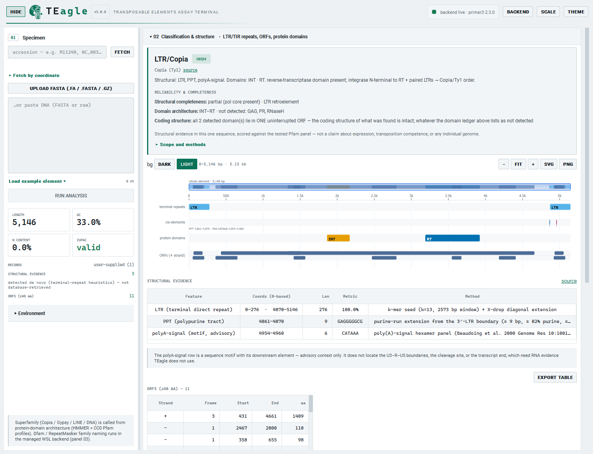

<div align="center">
<picture>
  <source media="(prefers-color-scheme: dark)" srcset="docs/img/teagle-banner-dark.png">
  
</picture>

  

**Single-sequence transposable-element evaluation and PCR target planning for Windows.**
</div>

TEagle connects structural evidence, protein domains, Wicker classification, family annotation, primer design, predicted products, and provenance in one native desktop workflow. It is designed for researchers working on individual elements or loci and requires no command line for routine use.

> **Article status:** The TEagle software article remains a work in progress; no journal publication is currently available. The application, documentation, and DOI-bound benchmark materials are available now.



## At a glance

| Step | TEagle provides |
|---|---|
| **Load** | Pasted sequence, FASTA, NCBI accession, genomic coordinates, or a bundled example |
| **Interpret** | Terminal features, ORFs, cis-elements, and a 30-model Pfam panel |
| **Classify** | Evidence-linked Wicker class, order, and superfamily calls, with unsupported levels withheld |
| **Annotate** | Optional Dfam family matching and transcript-guided splice detection |
| **Design** | Primer3 pairs, secondary-structure checks, predicted products, and a to-scale gel |
| **Check** | Candidate priming sites against a selected downloaded assembly and fixed criteria |
| **Record** | Versions, database checksums, parameters, input hashes, and explicit run states |

TEagle reports `complete`, `partial`, `withheld`, `failed`, and `not_run` separately. These states prevent an unavailable or unexecuted analysis from appearing as a negative biological finding.

## Install and start

1. Download the installer and illustrated manual from the [TEagle 4.0.0 release](https://github.com/tunabirgun/TEagle/releases/tag/v4.0.0).
2. Verify the published SHA-256 value, then run the installer. Windows SmartScreen may show **Windows protected your PC** because the installer is not code-signed; select **More info → Run anyway** if local policy permits it.
3. Launch TEagle, select **Load example element**, and press **Run analysis**. You can instead paste a sequence, open a FASTA file, or enter an NCBI accession.
4. Install optional Linux-backed components from **BACKEND** inside the application when Dfam, splice detection, or assembly functions are needed.

The Windows bundle includes the native runtime, Qt, Primer3, HMMER, and the bundled TE-domain profiles. Nothing needs to be installed with `pip`.

### Optional backend

TEagle installs and verifies its optional WSL2 environment from the graphical interface. Components are independently installable and repairable, with pinned package versions, integrity checks, and live progress. The panel shows the current default Dfam cost of 85 MiB downloaded and 0.6 GiB after extraction. Storage gates compare the WSL filesystem with the Windows backing volume and use the smaller available limit. NCBI Datasets does not resume a partial genome ZIP, so an interrupted genome download restarts that ZIP. WSL2 resource limits can be adjusted through `.wslconfig`; apply them with `wsl --shutdown` only after TEagle and other WSL work have stopped.

## Results and exports

The native application exports tables as **XLSX/CSV/TSV**, figures as **SVG/PNG/vector PDF**, and sequence or annotation data as **GFF3/BED/FASTA** where applicable. Validated runs can also export provenance JSON and complete-result JSON. The legacy browser has a deliberately narrower export surface and does not provide XLSX, PDF, provenance JSON, or complete-result JSON.

Right-click tables, features, and gel bands for context-specific actions such as copying a row, extracting sequence or flanks, sending coordinates to primer design, or exporting the selected result.

## Scientific scope

TEagle evaluates a selected sequence or locus; it is not a genome assembler, variant caller, or de-novo TE-family discovery system. Dfam labels depend on the installed library, and a family absent from that library cannot be reported. Primer products and assembly candidate sites are computational predictions that require experimental confirmation for wet-lab use.

Classification is evidence-bounded. Paired terminal direct repeats alone do not establish an LTR order, isolated domains do not force a finer lineage call, and a failed domain stage is recorded as unavailable rather than as zero detected domains. Assembly candidate-site labels are restricted to the selected assembly and criteria; they do not establish specimen-wide specificity.

Whole-genome RepeatMasker landscape annotation is available as a separate optional function. Its counts describe alignment rows or distinct matched models as labelled in the interface, while coverage uses contig-wise interval unions. This assembly-scale function is not part of the admitted 4.0.0 performance panel.

## Current benchmark and reproducibility

The TEagle 4.0.0 evaluation is linked to a public protocol lineage and independently downloadable result package:

- [Protocol concept](https://doi.org/10.5281/zenodo.22129307)
- [Final controlling protocol](https://doi.org/10.5281/zenodo.22154316)
- [Validated benchmark results](https://doi.org/10.5281/zenodo.22159977)

The public results archive contains 152 files and has SHA-256 `63559355f723a4a45c3b439e00dce283cc8b191855a5118d27a0dc94619961a6`. It preserves evaluated, partial, withheld, failed, and unexecuted branches instead of presenting only completed analyses.

The deployment evaluation executed 12 deterministic graphical-workflow cases on each of four exact Windows 10/11 guests. Ten required formats per case produced 480 verified export observations, 48 result documents, 48 manifests, and 144 cross-guest identity sets. These results support consistency across those exact guest observations; biological accuracy and wet-lab performance remain separate questions.

Every analysis records scientific software and database versions, parameters, and input checksums. Manifest schema 0.2 and analysis result schema 1.0 use deterministic SHA-256 content seals under an unkeyed integrity model; source-context schema 1.0 binds validated public-record identity to the sequence actually analysed. The seals detect accidental or uncoordinated changes but are not author authentication or a substitute for archiving the referenced software, databases, and inputs.

## Develop and build

```powershell
python app/teagle.py
python app/teagle.py --selftest
python -m pytest tests/ -q
powershell -File installer/build_installer.ps1
```

The installer pipeline freezes the application, checks the bundle, runs the headless self-test, and then builds the Inno Setup installer. Optional `@wsl` and `@network` test groups are gated separately.

## Documentation

- Illustrated user manual: attached to the [4.0.0 release](https://github.com/tunabirgun/TEagle/releases/tag/v4.0.0)
- Reproducible example workflow: [docs/TRY-IT-YOURSELF.md](docs/TRY-IT-YOURSELF.md)
- Current changes: [CHANGELOG.md](CHANGELOG.md)
- Software citation metadata: [CITATION.cff](CITATION.cff)
- Third-party components and licences: [THIRD-PARTY-NOTICES.md](THIRD-PARTY-NOTICES.md)

## License

TEagle is free software under the [GNU Affero General Public License, version 3 or later](LICENSE). Modified network deployments must make their corresponding source available to their users under the licence terms.
