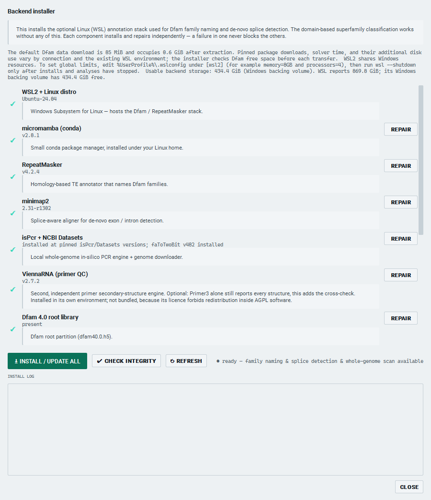

# TEagle — running the app (plain-language guide)

TEagle is a **native Windows desktop app** (PySide6/Qt). The following workflows run locally on the supplied data:

1. **Reads a DNA sequence** — paste, FASTA, or **fetch by accession live from NCBI** — and checks it.
2. **Finds structural features** — LTRs (the repeated ends of some transposons), inverted repeats (TIRs), ORFs (protein-coding stretches), and tails.
3. **Detects protein domains** — gag (matrix/capsid/nucleocapsid), protease, reverse transcriptase, RNase H, integrase, envelope, chromodomain, LINE ORF1p and apurinic-like endonuclease, tyrosine recombinase, Helitron helicase, and the Tc1/*mariner*, hAT, CACTA, MULE and IS4 transposases — from a **30-model Pfam panel** (bundled, CC0) using **HMMER** (runs natively, no Linux needed).
4. **Classifies the element** — Class I vs II, and superfamily: **Copia, Gypsy, DIRS, LINE, hAT, Tc1/Mariner, CACTA, MULE, IS4-like/piggyBac** — from the domain architecture. Copia vs Gypsy is decided by the diagnostic **integrase-vs-RT order**. Paired LTRs plus an envelope-domain hit additionally flag an **ERV/errantivirus architecture**; this flag does not replace the superfamily result.
5. **Designs PCR primers** with **Primer3**, including **domain-specific PCR** (primers placed inside a chosen domain).
6. **Runs in-silico PCR** — predicts which product(s) your primer pair would make, shown as a gel.

7. **Searches for a Dfam family match** — panel 03 uses RepeatMasker 4.2.4 with Dfam 4.0 through the managed **WSL backend** and reports any matched hit with its coordinates, divergence, and score. The separate whole-genome landscape workflow can instead use a user-supplied repeat-library FASTA; that file replaces Dfam for the run and is identified by its content checksum. Custom references need a recognized `#class/family` header to contribute to the TE percentage; matches without one remain visible as unclassified/other because their TE classification is unavailable.

> Everything is computed locally from the supplied data. The optional Linux-dependent workflows—RepeatMasker/Dfam family naming, splice alignment, whole-genome off-target scanning, and whole-genome TE annotation—run in a managed **WSL2** distribution. Single-locus structure, domain-based superfamily classification, primer design, and pasted-background in-silico PCR run natively on Windows.


Right-click any structural, ORF, domain, family, or amplicon row — or any feature in the genome viewer or gel — to copy its FASTA/DNA/coordinates/protein or design a primer there; hover a table header for a plain-language definition, or a figure feature for its size and type. In the native application, tables export to XLSX/CSV/TSV and figures to SVG/PNG/vector PDF. Element annotations export to GFF3/BED, and fetched or splice-derived gene models export to GFF3/BED/FASTA.

## The WSL backend (optional Linux-dependent workflows)

Family-level naming (e.g. `Copia_I`, `Gypsy-2_DM`) uses tools that only run on Linux, so TEagle manages a **WSL2** environment for them — you never touch a Linux shell.

- **BACKEND in the window header** (and the same button in panel 03, which also shows the backend status) opens a window listing every component — WSL2, micromamba, **RepeatMasker 4.2.4**, minimap2, isPcr + NCBI Datasets, optional ViennaRNA, the **Dfam 4.0** libraries, and FamDB config — each with a live status tick. Install the required stack, **install or repair a single component**, or run a **check-integrity** pass; the Dfam libraries are downloaded from a pinned, md5-verified source into WSL, and a corrupt extracted partition is replaced without manual deletion. A component that is not installed offers **Install**, one already there offers **Repair**, and every download reports its progress in the log pane as it runs. The panel states the derived default Dfam cost before installation (85 MiB downloaded and 0.6 GiB after extraction); package storage, solver time, and network time are additional variable costs. Because WSL's sparse virtual disk can report more space than its Windows backing volume can supply, the panel shows both capacities and uses the smaller limit for Dfam transfers, genome downloads, and whole-genome annotation. WSL2 resource limits apply globally: edit `.wslconfig` in the Windows user-profile directory if necessary, then run `wsl --shutdown` only after every install and analysis has stopped. Dfam archive transfers resume, but NCBI Datasets does not resume a partial genome ZIP, so retrying a timed-out genome preparation restarts that ZIP.


- **Which families are searched is a choice, and it changes the answer.** RepeatMasker reads Dfam's *curated* families unless it is asked for both. Outside a few intensively studied lineages, many models are uncurated; TEagle therefore reports the installed lineage-specific model count rather than treating a blank result as biological absence. Once both optional uncurated partitions are installed, panel 03 offers a **Library** choice (curated only, the default, or including uncurated). A requested uncurated search is blocked when either partition is absent. The setting is printed with the result and sealed into its provenance.
- Once ready, set the **species** (auto-filled from a fetched accession's organism) and click **Run family annotation**. TEagle runs RepeatMasker (RMBLAST) against Dfam in WSL and reports any matched family hits with coordinates, divergence, and score — Layer-A homology evidence that complements the domain-based superfamily.
- Coverage depends on the searched library. In the whole-genome landscape, RepeatMasker column 10 supplies the matched repeat name/model and column 11 its broader class/family label; column 10 is not necessarily a biological family. TE classification includes LTR, LINE, SINE, DNA, rolling-circle, retroposon, and Penelope-like (`PLE`) labels. Each repeat-name/model row reports its within-name interval union and raw alignment-row count. The TE, tandem, other, and all-repeat headlines are independent contig-wise unions; TE, tandem, and other can overlap and must not be summed. The headline TE count is the number of distinct TE repeat names/models. Percentages divide by all submitted FASTA bases, including ambiguous bases. Mean divergence is weighted by the aligned span of raw RepeatMasker rows, including overlaps and fragments; it is not a mutation rate or age. Custom matches without a recognized class remain unclassified/other and are excluded from the TE union because their classification is unavailable. Cached assemblies are rehashed before reuse and the genome checksum enters both the run signature and provenance seal. Security: sequence and library contents are piped to WSL as data, never built into a shell command.

---

## Run it

Version 3.9.0 is available from the [v3.9.0 release](https://github.com/tunabirgun/TEagle/releases/tag/v3.9.0). Verify the published SHA-256 checksum, run `TEagle-Setup-3.9.0.exe`, launch it from the Start menu or desktop, and use the manual attached to the same release. Nothing else is required for the native core — Python, Qt, Primer3, HMMER, and the Pfam profiles are bundled inside the app.

**From source** (developers) you need **Python 3.10+**. Open a terminal in the `TEagle` folder:

```powershell
python app/teagle.py             # native PySide6 window
python app/teagle.py --check      # just run the environment check and print it
python app/teagle.py --selftest   # headless self-test (imports + figure rendering + a real analysis)
python app/teagle.py --server     # legacy browser mode → http://127.0.0.1:8765
```

From source, the first run — and again after any upgrade — checks Python and the pinned packages and installs them for you, then starts. It records a signature so it doesn't reinstall on every launch. If an install fails it says so and refuses to start on a broken environment (never a silent half-start). The in-app **Environment** panel shows the live status (Python, packages, WSL2).

No command-line bioinformatics, no Linux needed for the core workflow.

## Fetch by accession (live)

Type a nucleotide accession in the Specimen box — e.g. **`M11240`** (Drosophila copia), **`NC_003075.7`** (Arabidopsis chr4), **`X05424`** (maize Ac) — and press **Fetch**. TEagle retrieves it from NCBI, shows the organism / taxid / length / title so you can **verify before analyzing**, and fills the sequence. Invalid or unknown accessions give a clear error, never a wrong sequence.

You can also **Upload FASTA** — a `.fa` / `.fasta` / `.fna` / `.txt` file, or a gzipped `.gz` (decompressed in the app) — instead of pasting or fetching.

Fetched sequences are **cached locally**, so re-fetching the same accession is instant and offline. An installed build stores this cache under `%LOCALAPPDATA%\TEagle\cache\fetch`; a source checkout uses `TEagle\.teagle\cache\fetch`. A cached fetch is labelled **"cached (local)."** Each explicit accession version (for example, `M11240.1`) is immutable and has its own cache key. The desktop interface does not expose a force-refresh control; enter the explicit version required for an analysis rather than assuming that a bare accession has advanced. The cached record retains its exact `accessionversion` and retrieval timestamp.

## Using it

| Panel | What to do | What you get |
|---|---|---|
| **01 Specimen** | **Fetch** an accession, paste DNA, or click **“Load example element.”** Press **Run analysis**. | Length, GC%, N%, IUPAC validity; counts of structural features and ORFs. |
| **02 Structure** | (auto-fills after analysis) | An interactive map (zoom / pan / export SVG+PNG+PDF) + tables: LTR/TIR spans, protein domains, ORFs, method used. If you **fetched** an annotated accession, a **gene-structure** figure + table shows its exons / introns / CDS straight from the record. |
| **Splice detection** | Paste a transcript / cDNA, press **Detect exons/introns** (needs the WSL backend). | De-novo exon–intron structure by spliced alignment (minimap2), with each intron's splice site checked against canonical GT–AG. |
| **Primer design** | Pick a **preset** (Standard / qPCR / High-specificity / Permissive) or open **Advanced parameters**, press **Design primers**. | Real Primer3 pairs — sequences (3′ end underlined = specificity-determining), Tm, GC, product size. |
| **In-silico PCR** | **Load** one or more pairs into the engine (reorder by drag or ↑ ↓, remove with ✕), optionally paste a background, press **Run**. | A **gel** (dark / white / UV / monochrome, exportable) with the predicted physical products, one lane per pair, and a table separating the contributing primer mechanism, intended-endpoint match, Primer3-target coverage, mismatches, and coordinates. |
| **Run provenance** | (auto-fills) | The exact tool versions, checksums, parameters and environment behind the result, plus verified JSON exports in the native app. The record supports audit and rerunning when the referenced inputs and dependencies remain available; it does not archive them. |

## Scope

The paste-a-background in-silico PCR check on panel **05** is a direct O(n·m) search over the sequence you supply, bounded by a hard cap of 4000 binding sites and 4000 amplicons so a repetitive template cannot exhaust memory; it is tuned for **single loci / elements** (up to ~tens of kb), not whole chromosomes. Whole chromosomes and whole genomes are handled by separate engines that run locally in the WSL backend: panel **06 Whole-genome off-target scan** runs a designed pair against a downloaded RefSeq assembly with isPcr, and **Manage genomes → Annotate TE landscape** runs RepeatMasker over a cached assembly in contig chunks.

## Honesty rules the app follows

- Primer-specificity language is scoped to the templates and criteria searched. A computational verdict does not establish wet-lab specificity.
- Primer3 target coverage and an intended-product endpoint match are separate 0-based half-open assessments. Without design-bound geometry they are reported as unassessed, not as failed or off-target. Non-templated 5′ tails contribute to the full predicted band length but not to the template-coordinate span.
- Structural findings are **candidate evidence**, never a family name.
- A source it did not run is shown as **not run**, a classifier that lacks support is **withheld**, and a failed or bounded stage is not rendered as a zero finding.
- Manifest schema 0.2 and analysis-result schema 1.0 use strict UTF-8 JSON and SHA-256 bindings. They detect content changes but are unkeyed integrity checks, not proof of authorship or origin.
- Source-context schema 1.0 preserves public accession or coordinate labels only when the provider context exactly matches the ordered record identifiers, lengths, and sequence hashes. A mismatch is treated as local input, and local FASTA headers are replaced in public exports by neutral hash-bound identifiers.
- **Click any detected domain** to see its DNA + protein sequence and copy it (DNA / protein / FASTA), or design a primer inside it.

Changing the specimen invalidates prior analysis, primer, PCR, annotation, and export state. Late results from an older request are discarded. The native app revalidates a manifest or complete analysis-result binding immediately before JSON export. The legacy browser shares the engine but deliberately exposes only CSV/TSV tables, SVG/PNG figures, FASTA, and gene/splice GFF3/BED/FASTA; it disables XLSX, PDF, provenance JSON, and complete-result JSON because it cannot independently verify those exports.

## Version-locked evidence

The separately deposited [v3.8.0 benchmark evidence](https://doi.org/10.5281/zenodo.21848814) contains sanitized corpus definitions, scored aggregates, compact provenance checks, and audit scripts. Those results apply to the tagged v3.8.0 implementation; they are not presented as a 3.9.0 execution. The 3.9.0 installer and clean-machine gates passed, but no new classification, assay, or prospective benchmark result is claimed. Exact regeneration of the historical evidence requires the tagged source and refetching the cited public records.

## What’s under the hood

- `backend/teagle_core/` — the real science (pure Python): `sequtil` (parse/validate/GC/N/reverse-complement/ORFs), `structural` (LTR/TIR/TSD/poly-A detection), `domains` (HMMER/pyhmmer), `classify` (superfamily), `primers` (Primer3 design + pair-aware in-silico PCR), `provenance` (the run manifest).
- `backend/engine.py` — the single source of truth: one validated function per operation, returning a result or raising a clear input error. Both the native app and the legacy web server call it.
- `native/` — the native PySide6 app (the “assay terminal”): `main.py` (window + panels), `engine_worker.py` (runs the engine off the UI thread), `figures.py` (genome viewer + gel SVG), `widgets.py` (interactive figure/table widgets).
- `backend/server.py` + `web/` — the legacy browser UI, kept for `--server` / headless use; it displays the same engine results.

Dependencies are pinned in `backend/requirements.txt` for reproducibility.
